# PBI Report Test: onboarding and user guide

*For everyone joining the team, viewers and editors. Also available as [Word](PBI-Report-Test-User-Guide.docx) and [PDF](PBI-Report-Test-User-Guide.pdf).*

Automated end-to-end testing of Power BI reports: pages, visuals, numbers and interactions, with screenshots, data differences, AI explanations and PDF/Excel exports.

| Item | Details |
|---|---|
| Website | `https://pbireporttest.adarishashank-klu.workers.dev` |
| Who this is for | Everyone joining the team (onboarding), viewers, and editors |
| Administrator | Shashank Adari (shashank.adari@cliffitsolutions.com) |
| Version | PBI Report Test 1.0 · November 2026 |

### Contents

- **1. Welcome**: what PBI Report Test does, roles, key terms
- **2. Onboarding**: getting access, first sign-in, finding your way around, your account
- **3. Viewer guide**: dashboard, runs, reviewing results, AI insights, exporting, trends, what changed
- **4. Editor guide**: Power BI sign-ins, report links, test suites and schedules, running and reviewing tests, accepting expected differences, sharing, data models and deeper drilling
- **5. Troubleshooting**
- **6. Glossary**

## 1. Welcome

PBI Report Test checks Power BI reports for you. It opens each report in a real browser, goes through every page, reads every visual and its numbers, clicks buttons, applies slicers, drills into hierarchies and hovers tooltips. It compares two versions of a report, for example **PROD** against **DEV**, and reports every difference with screenshots, the changed values and a plain-English AI explanation.

Typical uses:

- Before a release: confirm the DEV/UAT version of a report matches PROD, or that only the intended changes are there.
- After a dataset refresh or a DAX/measure change: spot numbers that moved unexpectedly.
- Regular health checks: catch visual errors, broken buttons and missing pages early.
- Sharing evidence: send a PDF or Excel report of a run to managers and stakeholders.

### 1.1 Roles

Everyone signs in with their own account. Your role decides what you can do:

| Role | What you can do | Typical person |
|---|---|---|
| **Viewer** | See the dashboard, runs, screenshots, data differences and AI analysis. Ask the AI questions about a run. Download PDF, Excel and other exports. Cannot change anything or start runs. | Managers, stakeholders, report consumers |
| **Editor** | Everything a viewer can, plus: add report links, connect Power BI sign-ins, create and edit test suites, start, cancel and delete runs, run AI analysis and publish results. | BI developers, testers |
| **Admin** | Everything an editor can, plus: add and manage users, settings and the audit log. | Team lead / owner |

### 1.2 Key terms

| Term | Meaning |
|---|---|
| **Report link** | A saved Power BI report address (for example the PROD or the DEV version), with a friendly name and label. |
| **Report A / Report B** | In a comparison, A is the baseline (usually PROD) and B is the candidate being checked (usually DEV or UAT). |
| **Test suite** | A saved test: which reports to compare and which checks to run, with tolerances. You run a suite as often as you like. |
| **Run** | One execution of a suite. A run produces many checks and a result (Passed, Differences found, Failed…). |
| **Check (result)** | One individual test inside a run, for example "Card · Total Sales" or "Click button · Go to Details". |
| **Power BI sign-in** | The Microsoft account the tool uses to open secured reports. Not related to how you sign in to this website. |

## 2. Onboarding: getting started

### 2.1 How you get access

An administrator creates your account. You receive **sign-in instructions** by Teams or email with three things:

- The sign-in address: `https://pbireporttest.adarishashank-klu.workers.dev`
- Your email address (this is your user name)
- A **temporary password**, for example `Kp7m-Wq4x-Hr9t-Bz3c`

> **Important:** The temporary password works **once** and **expires after 72 hours**. If it has expired, ask your administrator for a new one. There is no self-registration.

### 2.2 Your first sign-in

1. Open the sign-in address in Chrome, Edge, Safari or Firefox. Bookmark it.
2. If you see **"PBI Report Test is waking up"**, wait: the site sleeps when nobody uses it and takes up to a minute to start. The page refreshes by itself.
3. Enter your email and the temporary password, then click **Sign in** (Figure 1). Click **Show** to check what you typed; a warning appears if Caps Lock is on.
4. Choose your own password (Figure 2). It must have **at least 10 characters**, must not be a common password, and must not contain the part of your email before the @. The checklist turns green when it is acceptable.
5. Click **Save password and continue**. You arrive on the **Dashboard** (Figure 3).

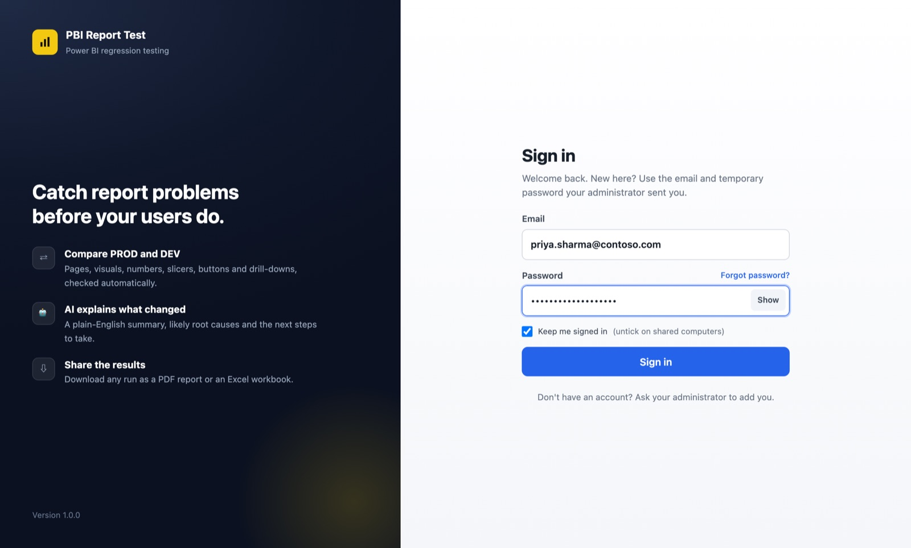
*Figure 1. The sign-in page*

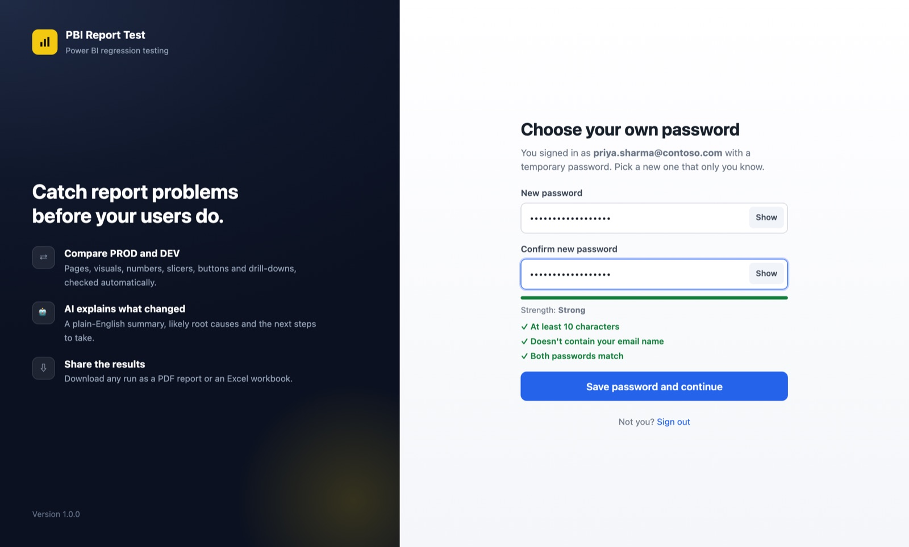
*Figure 2. Choosing your own password at first sign-in*

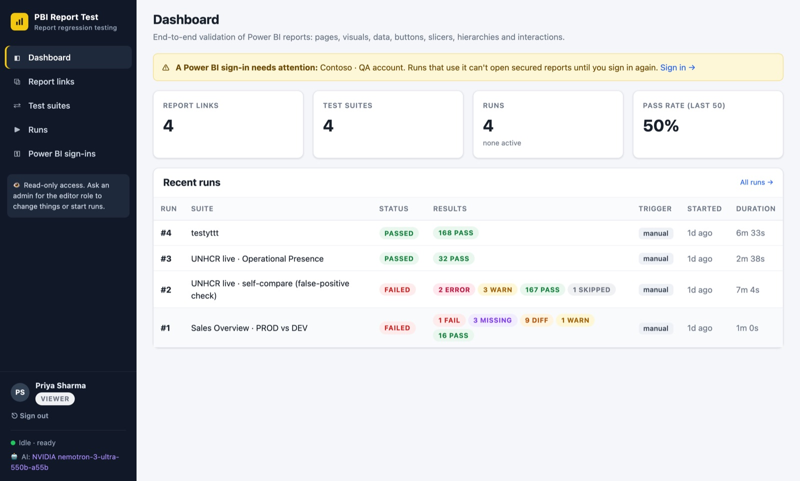
*Figure 3. The dashboard, as a viewer sees it*

### 2.3 Finding your way around

The menu on the left takes you everywhere:

| Menu item | What it is for |
|---|---|
| **Dashboard** | Totals, pass rate of the last 50 runs, recent runs, and warnings that need attention. |
| **Report links** | The Power BI reports the team tests (PROD, DEV, UAT…). |
| **Test suites** | Saved tests: which reports to compare and what to check. Editors start runs here. |
| **Runs** | Every test run with its result. Open a run to see screenshots, differences and AI analysis. |
| **Power BI sign-ins** | The Microsoft accounts used to open secured reports (editors manage these). |
| **Admin** | Users, settings and audit log (administrators only). |

At the bottom of the menu you see your name and role (click it to open **My account**), **Sign out**, whether a test is running ("Idle · ready" or "Validation running") and whether AI analysis is available. Viewers also see a "Read-only access" note.

### 2.4 My account

Click your name at the bottom of the menu (Figure 4). There you can:

- **Change your display name.**
- **Change your password.** Other devices are signed out when you do.
- **See signed-in devices** and sign them out, for example a computer you no longer use.
- **Create personal API keys** for automation (editors, see 4.10). A key is shown only once.

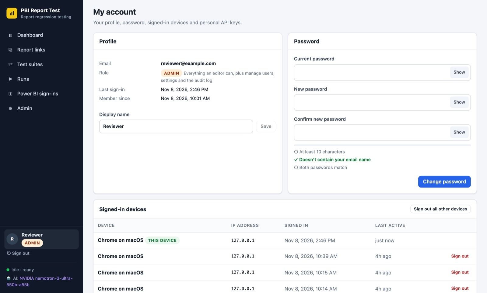
*Figure 4. My account: profile, password, devices and API keys*

### 2.5 Staying signed in, and security

- **Keep me signed in** is ticked by default. Untick it on shared or public computers: you are then signed out when the browser closes.
- You are signed out automatically after **72 hours without activity**, and after **30 days** at most.
- After several wrong passwords, sign-in is blocked for **15 minutes**.
- Never share your password. Each person must have their own account; ask your administrator to add colleagues.
- Everything you change is recorded in an audit log (who, what, when, from where).

### 2.6 Forgotten password

Click **Forgot password?** on the sign-in page for a reminder, then ask your administrator. They click **Reset password** next to your name and send you a new temporary password; sign in with it and choose a new password as in 2.2.

### 2.7 For administrators: adding a team member

1. Go to **Admin → Users** and click **+ Add user** (Figure 5).
2. Enter the person's work email and name, and choose the role: **Viewer** (read-only), **Editor** or **Admin**.
3. Click **Add user and generate password**. A temporary password is created automatically (Figure 6).
4. Click **Copy sign-in instructions** and send the message by Teams or email. It contains the address, email, temporary password and expiry.

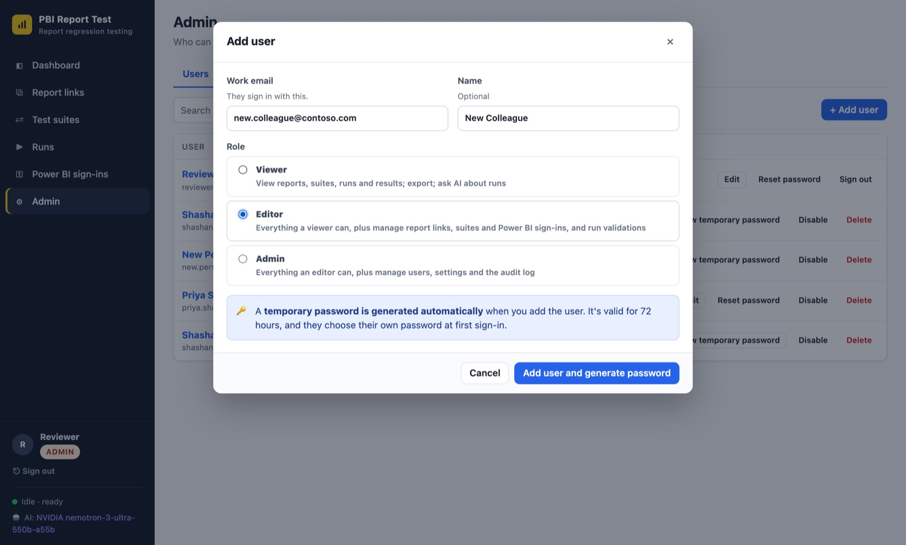
*Figure 5. Adding a user: the temporary password is generated automatically*

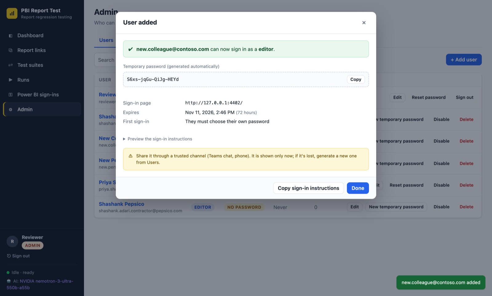
*Figure 6. The new user's temporary password and ready-to-send sign-in instructions*

- The Users list shows **Invited · expires in 3 days**, **Temp password expired** or **Active**.
- **New temporary password** issues a fresh one (the old one stops working immediately).
- **Edit** changes the role; **Disable** blocks access without deleting history; **Delete** removes the account (runs they started are kept).

## 3. Viewer guide

As a viewer you can look at everything and share results, but you cannot change settings or start tests. Buttons for editing are hidden for you.

### 3.1 The dashboard

The dashboard (Figure 3) shows the number of report links, test suites and runs, the **pass rate** of the last 50 runs, and the most recent runs. A yellow banner means a Power BI sign-in needs attention; this is for editors to fix and does not affect what you can see. Click a run to open it, or **All runs →** for the full list.

### 3.2 The Runs page

The Runs page (Figure 7) lists every run, newest first, with its suite, result, counts per status, who started it, when, and how long it took.

- Use **All suites** and **Any result** at the top to filter.
- **Export to Excel** downloads the list as a workbook.
- **⇩ PDF** on a row downloads that run's PDF report directly.
- Click a row to open the run.

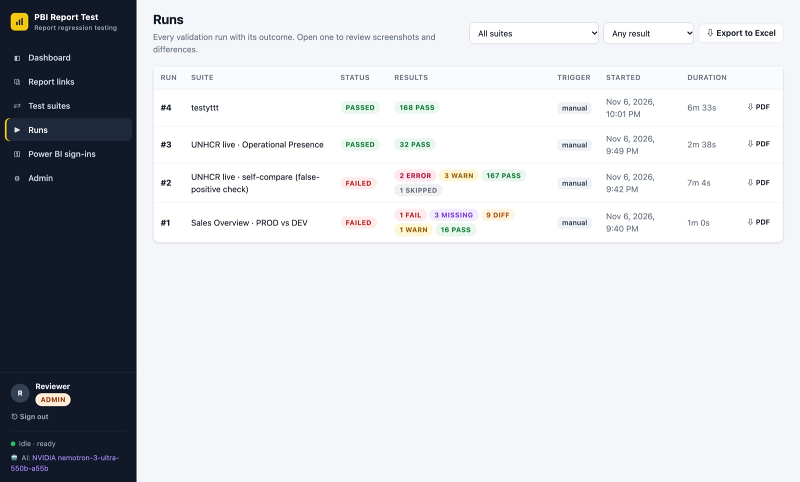
*Figure 7. The Runs page*

A run ends with one of these results:

| Run result | Meaning |
|---|---|
| **Passed** | Every check passed (warnings and skipped checks allowed). |
| **Differences found** | Only visual or data differences were found. Review them: they may be intended changes. |
| **Failed** | At least one check failed, something is missing, or a visual errored. Needs attention. |
| **Error** | The run could not finish, for example the report could not be opened. The message on the run page explains why. |
| **Cancelled** | Someone stopped the run. Results captured until then are kept. |

### 3.3 Reviewing a run

The run page (Figure 8) shows the result, who started it and when at the top, then the two reports compared (A ⇄ B) and a row of filter chips.

- The run opens on **Problems**: only the checks that need attention. Click **All** to see every check, or a status chip (Fail, Missing, Diff…) to see only those.
- Below the chips, filter by **scenario** (Visual, Button, Slicer…), by **page**, or search titles.
- Checks are grouped by report page. Each row shows the status, the scenario, the title, small screenshots and the percentage of pixels that differ.
- The tabs switch between **What changed** (comparisons only, see 3.8), **Results**, **AI insights**, **Ask AI**, **Coverage** (a table of statuses per scenario) and **Log** (technical progress messages).

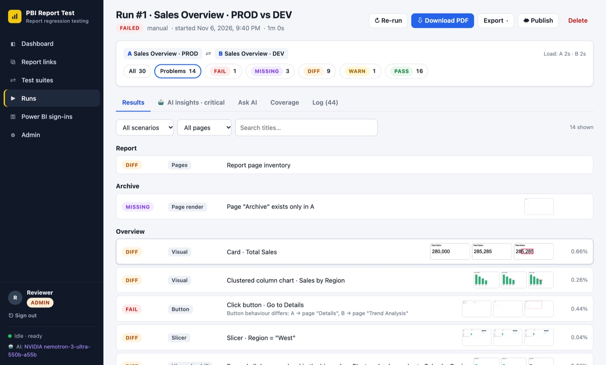
*Figure 8. A run, filtered to the checks that need attention*

Each check has a status:

| Status | Meaning | What to do |
|---|---|---|
| **Pass** | A and B match (within the suite's tolerances). | Nothing. |
| **Diff** | Screenshots or values differ. | Look at the images and data: intended change or a mistake? |
| **Fail** | Behaviour differs, for example a button goes to a different page. | Investigate; usually a defect. |
| **Missing** | A page or visual exists on one side only. | Check whether it was removed or renamed on purpose. |
| **Warning** | Something unusual that is not a definite failure, for example an interaction with no visible effect. | Review when convenient. |
| **Error** | The check could not be completed, or a visual shows an error. | Investigate; may also be a report error. |
| **Accepted** | A difference an editor marked as expected (for example an intended change). Shown for transparency; it does not count as a problem. | Nothing. Open it to see who accepted it and why. |
| **Skipped** | Not applicable or turned off. | Nothing. |

### 3.4 Looking at one check

Click a check to open it (Figure 9):

- **Side by side**: A, B, and B with the differing areas outlined in red.
- **Swipe**: drag the slider to wipe between A and B. Good for small shifts.
- **Pixel diff**: differing pixels highlighted in red.
- **Outlined differences**: B with red boxes around each differing region.
- Click any image to enlarge it.
- **Data differences**: a table of the values read from the visual in A and B. Added lines are green, removed lines red, changed lines yellow.
- **Data behind the visual**: the rows Power BI loaded for the visual, unrounded, compared between A and B. This catches a difference the screen hides, such as 1,200,001 against 1,249,999 when both show as "1.2M", or a row below the visible part of a table.
- **AI screenshot analysis**: a short description of what changed, its severity, and whether it is probably just rendering noise.
- Use the **← →** arrow keys (or Previous / Next) to step through checks. **Esc** closes the window.

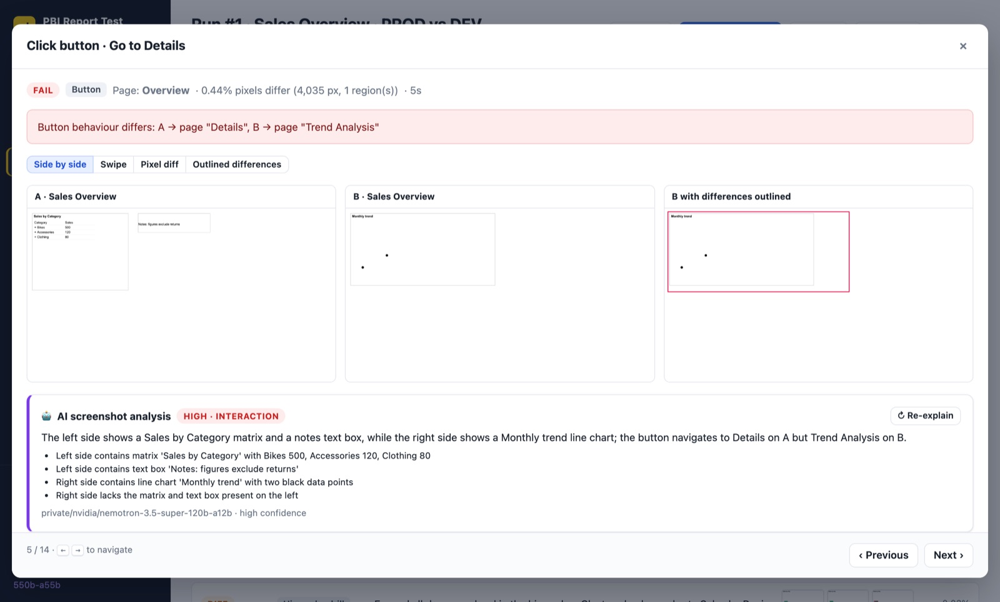
*Figure 9. One check: side-by-side screenshots and the AI explanation*

### 3.5 AI insights and Ask AI

When AI analysis is available, the **AI insights** tab summarises the run (Figure 10):

- A one-line **verdict** and a **risk level** (none, low, medium, high, critical).
- A short **summary** written for a release manager.
- **Likely root causes**, for example "Dataset refresh or measure/DAX change", with confidence and the checks behind them. Click a number like **#11** to open that check.
- **Next steps**, **Triaged findings** grouped by severity, **Data anomalies** (numbers that look inconsistent), and **Probably noise** (differences that are likely harmless).

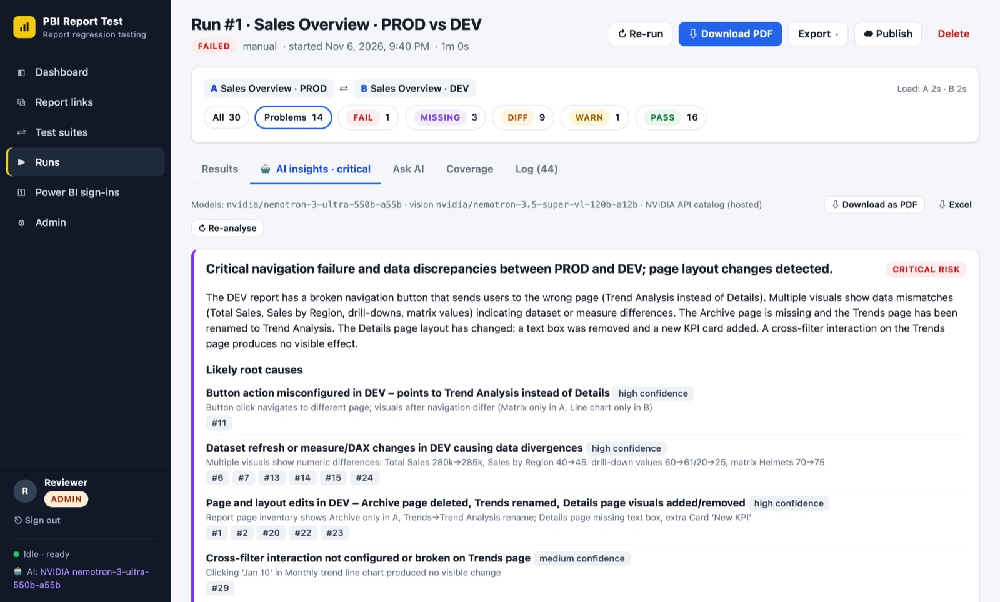
*Figure 10. AI insights: verdict, risk, summary and likely root causes*

On the **Ask AI** tab you can ask questions in plain English, for example "Which numbers changed on the Overview page?" or "Why did the Region slicer check fail?". Answers refer to the checks they are based on.

> **Important:** AI output can be wrong. Treat it as a helpful starting point and confirm important conclusions with the screenshots and data differences.

### 3.6 Exporting and sharing

On a run page, click **⇩ Download PDF**, or open **Export** for other formats (Figure 11). The AI insights tab also has **Download as PDF** and **Excel** buttons.

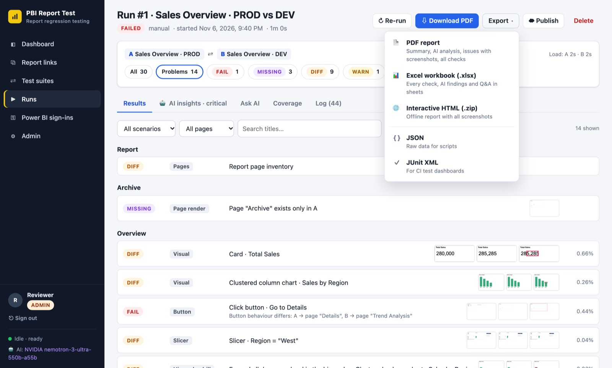
*Figure 11. Export options on the run page*

| Format | Contains | Best for |
|---|---|---|
| **PDF report** | Cover with result and AI risk, summary, AI findings and root causes, every check needing attention with screenshots, questions asked to the AI, and a list of all checks. | Managers and stakeholders; release evidence |
| **Excel workbook (.xlsx)** | Sheets: Summary, Checks (every check with what went wrong), AI analysis, AI questions. | Filtering, sorting, tracking fixes |
| **Interactive HTML (.zip)** | An offline copy of the run with all screenshots; open index.html after unzipping. | Sharing the full detail with someone without an account |
| **JSON / JUnit XML** | Raw data and test results in standard formats. | Scripts and CI dashboards |

> **Tip:** Building a PDF takes a few seconds; a message appears while it is prepared and when it has downloaded.

### 3.7 Trends

To see how a suite is doing over time, click **Trends** on its card in **Test suites**, or on the Runs page when it is filtered to one suite (Figure 12). The dashboard also shows a chart of the last 30 runs once there are at least two.

- The tiles show the number of runs, the share that passed, how many checks needed attention in the last run (and whether that went up or down), and the average run time.
- **Check outcomes per run**: one column per run, split into **Passed** (green), **Accepted as expected** (blue) and **Needs attention** (red). Hover a column for the numbers; click it to open the run.
- **Run time**: how long each run took.
- Choose the last 10, 30 or 90 runs at the top, or tick **Show as table** to see the same numbers as a table.

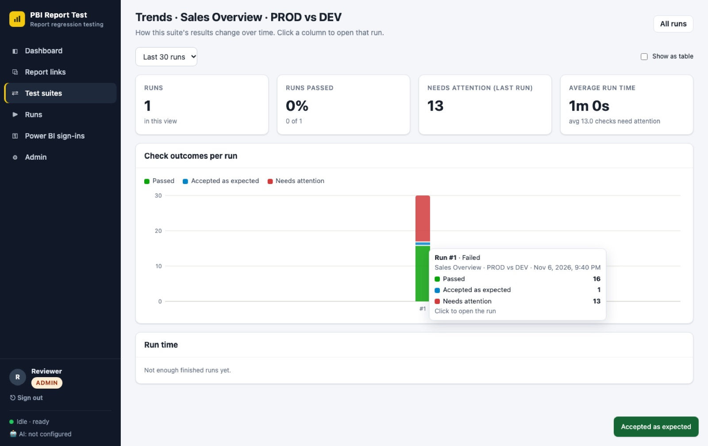
*Figure 12. Trends for one suite, with a column's details on hover*

### 3.8 What changed

For a comparison run, the **What changed** tab answers "what is different in B?" from the top down: the whole report, then each page, then each visual, then the exact values (Figure 13).

- **The headline** sums it up in one line, for example "pages: 1 removed, 1 renamed · visuals: 1 added, 1 removed · 4 value changes in 2 visuals · data model: 5 changes".
- **The tiles** count pages changed, visuals added or removed, values changed and interactions that behave differently (buttons, slicers, drills, cross-filters, tooltips).
- **Data model** compares the two semantic models: tables, columns, measures (DAX), relationships and security roles. Click a group, for example **Measures (DAX)**, to list what was added, removed or changed, and **Show the difference** to see the old and new DAX side by side. If the model could not be read, the panel says why; editors can fix that (4.12).
- **Pages** is a heatmap with one tile per page, from **No change** (grey) to **High** (dark blue). The level is always written on the tile too. "Only in A" means the page was removed or hidden in B; "Trends → Trend Analysis" means it was renamed.

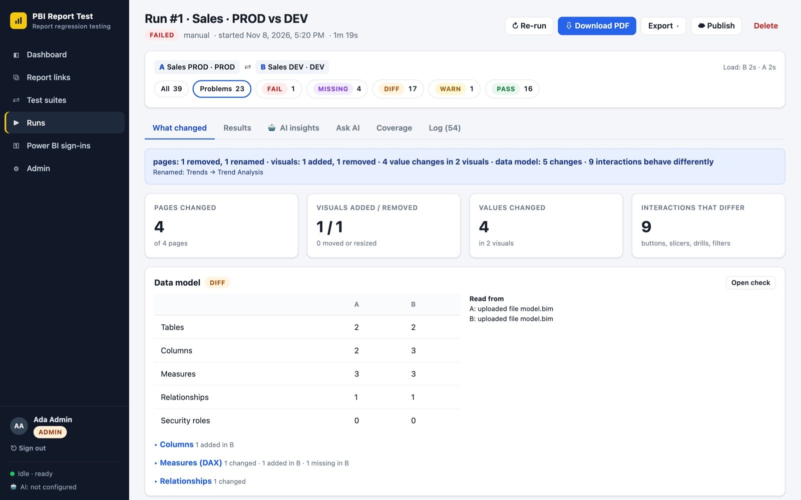
*Figure 13. What changed: headline, totals, data model and the page heatmap*

At the top, **Action items for the Power BI team** lists what to look into first: priority **P1** (wrong or changed numbers, missing pages or visuals, data model or security changes), **P2** (behaviour users notice) and **P3** (cosmetic or new things), each with the exact before → after, the likely cause, who should act, and links to the checks. When AI is configured the list is written by the AI, which groups everything caused by one change into one item; otherwise it is ranked automatically. The same list opens the PDF report and is a sheet in the Excel export.

Click a page tile to open that page (Figure 14):

- **Compared on**: the slicer values both reports showed when this page was compared, for example Region = North · Year = 2026. "(B set to A)" means B opened on other values and was aligned first; a table with **differs** means the two sides could not be put on the same values, so read the differences below with care.
- **Layout**: visuals added, removed, moved, resized or retitled.
- **Visuals**: every visual that looks or reads differently. Click its name to see each changed value: the **Row** it belongs to (for example JAN · North), **A (before)** in red and **B (after)** in green. Rows that are the same in both are left out. "No data change" means only the picture differs.
- **Slicers that open on different values**: the slicer, what A and B show when the page opens, and the values both were set to before comparing.
- **Interactions that behave differently**: for example a button that goes to another page, or a drill that shows other numbers at level 2.
- **Open check** opens the full evidence: screenshots, data and the AI explanation. Click **Report** in the breadcrumb to go back to all pages.

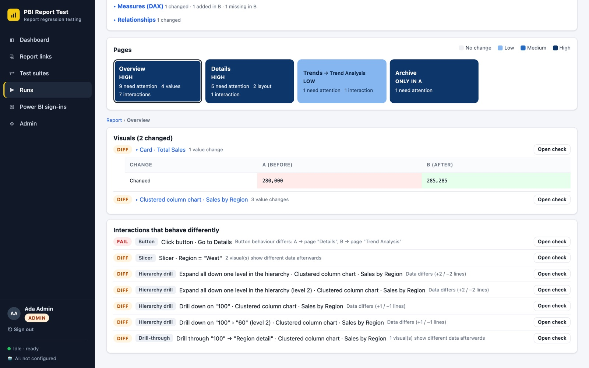
*Figure 14. One page: the changed value of a card, and the interactions that differ*

> **Tip:** The PDF report has the same summary near the top and a **Page by page** section: each page with the filters it was compared on and every difference as Row: A → B. The Excel export adds the sheets **What changed**, **Value changes** and **Model changes**, with a **Compared on** column.

## 4. Editor guide

Editors set up and run the tests. Everything in the viewer guide applies to you too.

### 4.1 The workflow at a glance

1. **Connect a Power BI sign-in** for secured reports (not needed for public "publish to web" links).
2. **Add report links** for each version you want to test, for example PROD and DEV.
3. **Create a test suite** that compares A (baseline) with B (candidate) and chooses the checks.
4. **Run** the suite and follow its progress.
5. **Review** the problems, with help from the AI insights.
6. **Share** the result as a PDF or Excel file, then fix and re-run as needed.

### 4.2 Power BI sign-ins

Secured reports on app.powerbi.com need a Microsoft account to open them. A **Power BI sign-in** stores that session so tests can run unattended (Figure 15).

1. Go to **Power BI sign-ins** and click **+ New sign-in**. Give it a clear name, for example "Contoso · QA account".
2. Click **Sign in**. A window shows the Microsoft sign-in page, live, from a browser running on the PBI Report Test server (Figure 16). Click into the page and sign in as usual: email, password, then MFA (for example approve the number in Microsoft Authenticator). Tick **Stay signed in** when asked.
3. When Power BI opens, the session is saved and the window closes by itself. Click **Check** to confirm the status is **Active**.

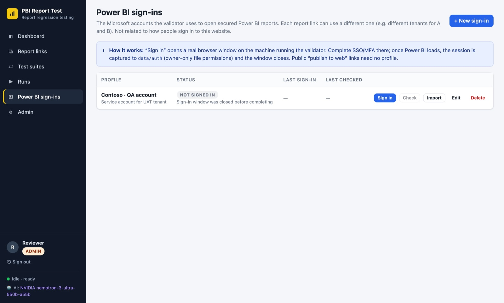
*Figure 15. Power BI sign-ins*

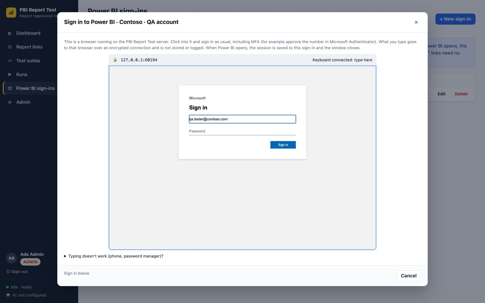
*Figure 16. Signing in from the website: the sign-in page is shown live; click and type into it*

- What you type goes to that browser over an encrypted connection and is not stored or logged. Only the resulting Power BI session is saved.
- If typing doesn't reach the page (for example on a phone or with a password manager), open **Typing doesn't work?** under the picture, click the field in the page, then type in the box and click **Send**.
- The window closes after 5 minutes without activity; click **Sign in** again to restart.
- Alternative: on a computer with PBI Report Test installed, run `npm run login -- "Contoso · QA account"`, then click **Import** next to the sign-in and choose the file it produced.

- Use a dedicated test account where possible, not your personal account.
- If reports A and B live in different tenants, create one sign-in for each.
- Sessions expire. When one does, the dashboard shows a warning and runs report "Redirected to sign-in"; sign in or import again.

### 4.3 Report links

Go to **Report links** and click **+ Add report link** (Figures 17 and 18):

| Field | What to enter |
|---|---|
| **Name** | A friendly name, for example "Sales Overview". |
| **Environment / label** | PROD, DEV, UAT… Shown next to the name everywhere. |
| **Report URL** | Any Power BI address: service link (app.powerbi.com/groups/…/reports/…), app link, embed link or publish-to-web link (…/view?r=…). Any page of the report works; all pages are found automatically. |
| **Power BI sign-in** | The sign-in to use. Choose "None" for public publish-to-web links. |
| **Tags / Notes** | Optional, for your own organisation. |

Click **Discover** on a report link to check it before testing: the tool opens the report and lists its pages with thumbnails, the number of visuals, and the buttons, slicers and charts it found. If it cannot open the report, the message tells you why, for example "Sign-in required".

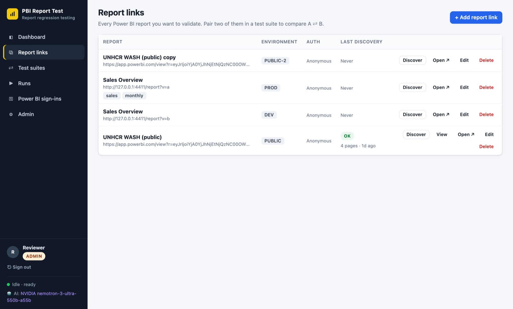
*Figure 17. Report links*

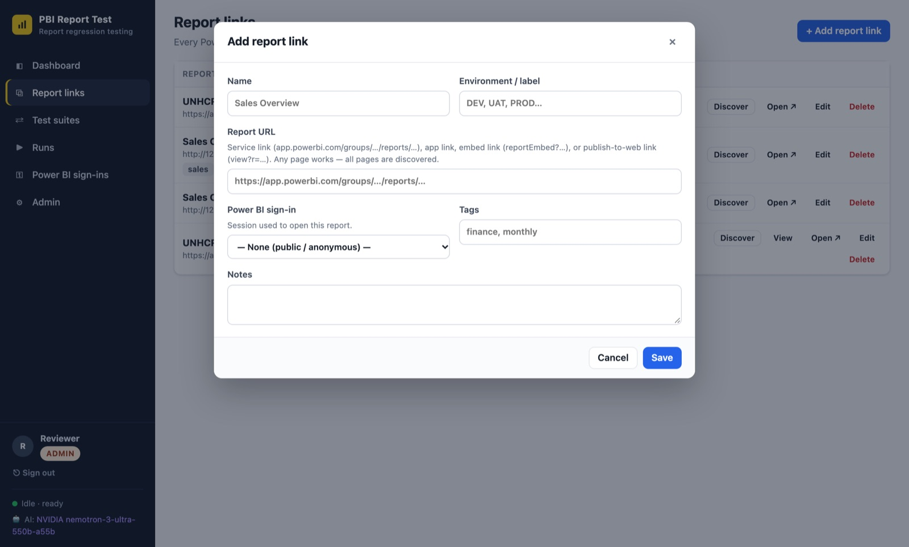
*Figure 18. Adding a report link*

### 4.4 Test suites

Go to **Test suites** and click **+ New suite** (Figures 19 to 21). The editor has four tabs.

#### Basics

- **Suite name** and an optional **description** ("what is this suite protecting?").
- **Mode**: **Compare A ⇄ B** compares a baseline (A) with a candidate (B). **Validate single report** checks one report's rendering, visual errors and interactions on its own.
- **Report A (baseline)** and **Report B (candidate)**: choose from your report links.
- **Schedule (optional)**: a cron expression, for example `0 6 * * 1-5` for weekdays at 06:00 India Standard Time. Leave empty to run on demand.
- **Pages to include / exclude**: one per line, exact page names or a pattern like `/^Tooltip/`. Empty means all pages.

> **Note:** Schedules work even while the website is asleep: it wakes up by itself when a suite is due, runs it, and goes back to sleep. Times are **India Standard Time (Asia/Kolkata)**. If a scheduled run was missed (for example during maintenance), it runs once as soon as possible, unless it is more than 24 hours late. The suite card shows when the next run is due.

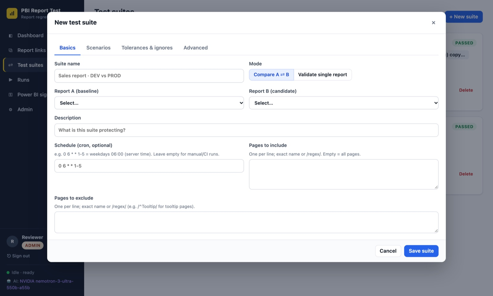
*Figure 19. A new test suite: Basics*

#### Scenarios: what to check

The page inventory (pages added, removed, renamed or reordered) is always checked. Turn the other scenarios on or off:

| Scenario | What it checks |
|---|---|
| **Page render** | Full-page screenshot of every page, plus visual errors. |
| **Layout & inventory** | Visuals missing, added, moved, resized or retitled. |
| **Every visual** | A screenshot and the data of each visual (cards, tables, matrices, chart values). |
| **Buttons & navigators** | Clicks buttons and page/bookmark navigators and checks where they go and what changes. |
| **Slicers** | Applies slicer values and compares the filtered page and data. |
| **Same slicer values on both sides** | On by default. Before a page is compared, B's slicers are set to the values selected in A, so both pages show the same selection. A slicer that opens on different values is reported once, on its own (see below). |
| **Hierarchy drill** | Drills down, expands all and goes to the next level on hierarchical visuals, level by level (for example Year → Quarter → Month), and compares every level. |
| **Drill-through** | Right-clicks a data point → Drill through to each target page, and compares the page each report lands on. |
| **Matrix +/- expand** | Expands matrix row groups and compares the expanded data. |
| **Cross-filtering** | Clicks data points and compares how the rest of the page reacts. |
| **Tooltips** | Hovers data points and compares tooltip content. |
| **Data behind each visual** | On by default. Compares the data Power BI downloads for each visual: every row it loads, unrounded. Reported with the visual it belongs to. |
| **Data model** | Compares the two semantic models: tables, columns, measures (DAX), relationships, security roles and shared queries (see 4.12). |

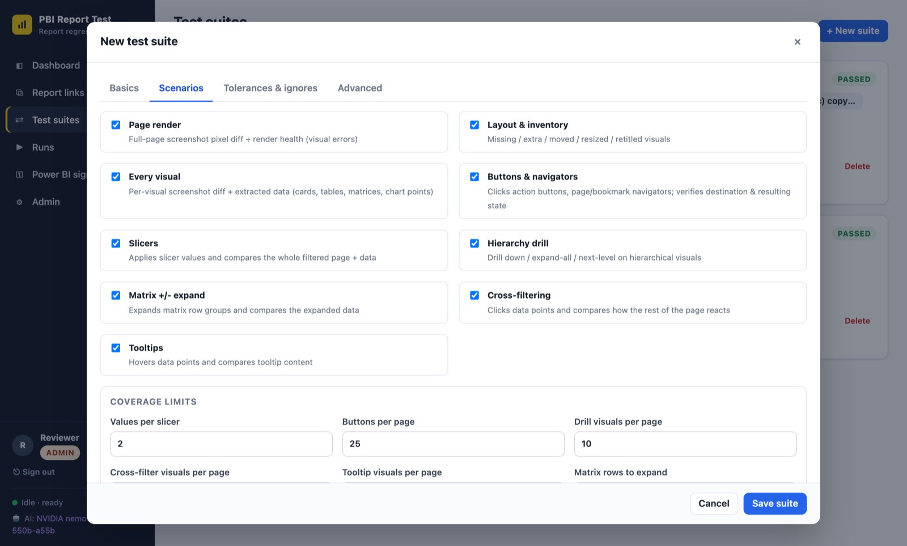
*Figure 20. Choosing scenarios, coverage limits and AI options*

**Why "same slicer values" matters.** If a slicer opens on North in A but on South in B, every visual on that page shows different numbers, and the real differences are buried under them. With this option on, the run first records the slicer itself as one finding ("Sector" opens on different values: North (A) vs South (B)), sets B to North, and only then compares the page. Every other difference on that page is then a real one. Date and range slicers are handled the same way: B is given A's from and to values, and the run checks that Power BI accepted them; if it did not, the finding says the page was compared on different ranges. Turn the option off only if you want to see how each report looks exactly as it opens.

**Fixed parameters** (same tab) set slicers to chosen values on **both** reports before comparing, for example to always compare one business unit. Write one per line: `Sector = North`, or several values and a page: `Region = East, West @ Sales overview`. Without a page, the parameter applies to every page with that slicer. Leave the values empty (`Region =`) to clear a slicer. A value that one report does not have is reported as a failure. Date and range slicers are not set automatically.

On the same tab, **coverage limits** set how much is tested (for example values per slicer, buttons per page, **drill depth** and **data points drilled per visual**): higher is more thorough but slower (see 4.12 for how much slower). **AI analysis** options turn on the automatic AI summary after each run and AI explanations of screenshot differences.

#### Tolerances & ignores

- **Max differing pixels (%)**: above this a screenshot counts as different. Raise it slightly if harmless anti-aliasing creates Diff results.
- **Per-pixel colour tolerance**, **layout jitter (px)** and **position/size tolerance (px)**: ignore tiny rendering shifts.
- **Small change size (px)**: in page and visual screenshots, this many differing pixels in one spot count as a difference even when they are far below the percentage above (one changed digit, one marker). Default 40; set 0 to turn it off. It does not apply to screenshots taken after an interaction, where hover and highlight effects cause small harmless differences.
- **Numeric tolerance**: for example `0.001` treats values within 0.1% as equal (useful for rounding).
- **Retries per scenario**: retry flaky interactions.
- **Ignore visual types / titles**, **ignore text patterns** (for example `Last refreshed: .*`) and **mask in screenshots** (areas painted over in both screenshots): use these for content that changes every time, such as refresh dates.

#### Advanced

Browser size, language, time zone, timeouts and the maximum number of visuals per page. Leave these at their defaults unless a report needs more time to load.

- **Time budget (minutes)**, default 15: every page always gets its screenshot, layout and data checks; buttons, slicers, drills and other interactions use the remaining time. Interactions that don't fit are listed as **Skipped: time budget**. Set 0 for no limit.
- **Pages tested at the same time**: 0 uses the server's setting. More pages at once is faster only if the server has the processing power for it.

> **Tip:** Start with the defaults and run once. To make sure a suite raises no false alarms, create a copy with the **same report as A and B**: it should pass. Then tune tolerances and ignores to remove noise.

Each suite card (Figure 21) shows its last result and has **▶ Run now**, **History** (its runs), **Edit**, **Duplicate** and **Delete** (past runs are kept).

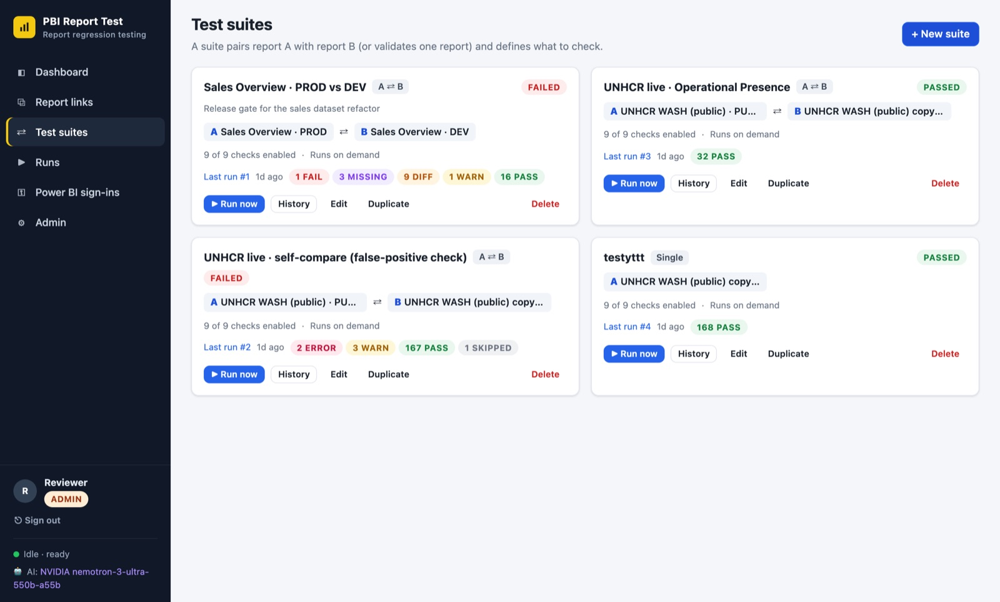
*Figure 21. Test suites*

### 4.5 Running a test

1. On **Test suites**, click **▶ Run now**. The run page opens.
2. Watch the progress bar, the current phase and the **Log** tab. You can leave the page: the run continues in the background.
3. When it finishes, the result and the **Download PDF** and **Export** buttons appear. If AI analysis is switched on, it starts automatically and takes a minute or two.

- **Cancel** stops a run; results captured so far are kept.
- **Re-run** starts the same suite again, for example after a fix.
- **Delete** removes a run and its screenshots.
- A run takes from about a minute to ten minutes or more, depending on the number of pages, visuals and interactions. On the cloud website the app stays awake until a run has finished.

### 4.6 Reviewing and deciding

1. Start with the **Problems** filter and the **AI insights** tab for an overview.
2. Open each check: **Fail**, **Missing** and **Error** are almost always real issues; **Diff** needs your judgement.
3. For each difference decide: **a defect** (raise it with the report developer) or **an intended change** (fine).
4. If a difference is intended, **accept it as expected** (4.7). If many differences are harmless noise, adjust the suite's tolerances or ignores and re-run.
5. Share the outcome (4.9) and re-run after fixes until the result is what you expect.

### 4.7 Accepting expected differences

Some differences are intended: a new KPI, a renamed page, numbers restated on purpose. Accept them once so later runs of the suite stop flagging them, and reviewers only see what is new.

1. Open the check in a run and click **✓ Accept as expected** (Figure 22).
2. Choose what to accept:

   - **This exact difference** (recommended): later runs accept it while the difference stays the same. If the values, behaviour or missing items change again, it is flagged again.
   - **Any difference in this check**: for content that legitimately changes every time, such as a visual showing today's figures. The check is not flagged for this suite until you stop accepting it.

3. Add a short reason, for example "New KPI added in release 4.2", and click **Accept**.

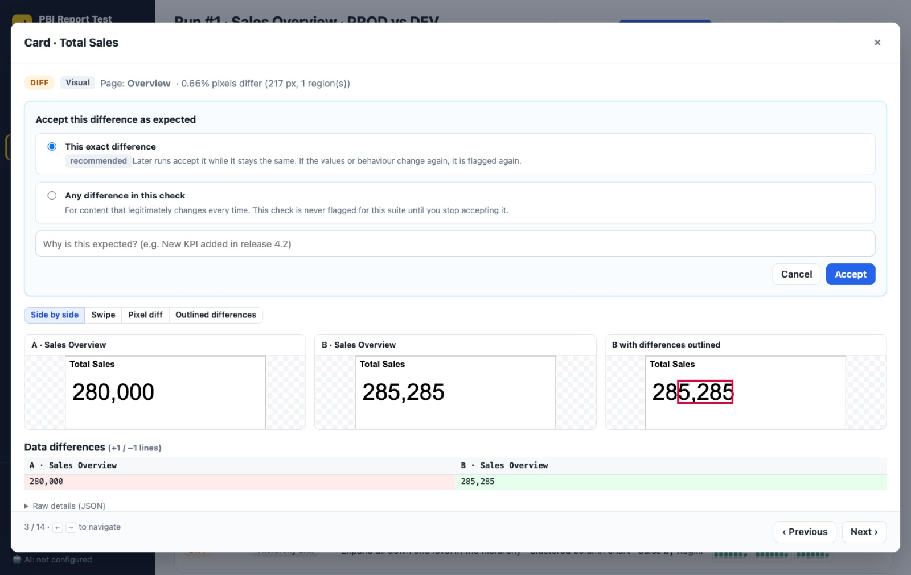
*Figure 22. Accepting a difference as expected*

The check now shows **Accepted**, with who accepted it, when and why (Figure 23), and the run's result is recounted straight away. Accepted checks are listed separately in the PDF report and marked in the Excel workbook.

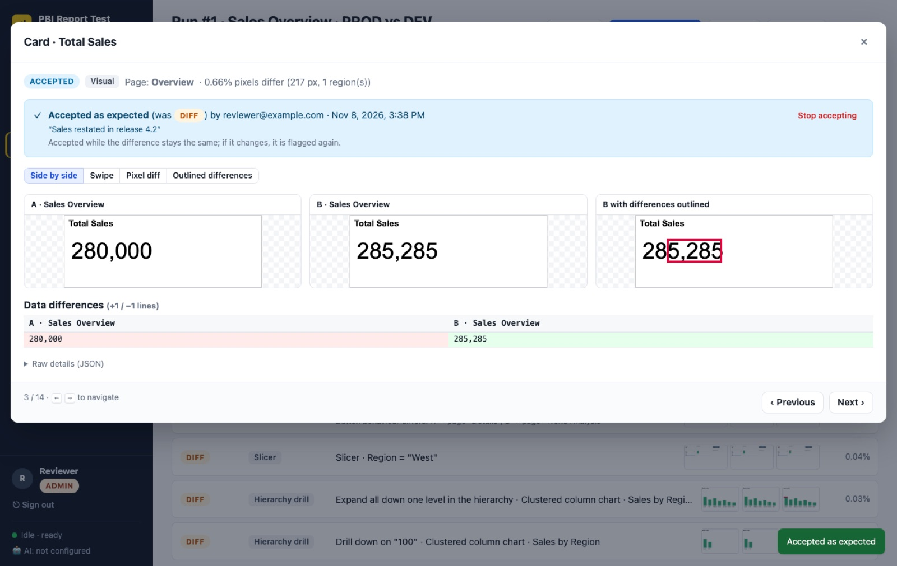
*Figure 23. An accepted check, with the reason and a Stop accepting button*

- To undo, click **Stop accepting** on the check, or open the suite (**Edit**) and use the **Accepted differences** tab, which lists every accepted difference with how often it has matched since.
- Undoing flags the check again in every run of the suite where it was accepted.
- Accept only what you have checked. When in doubt, ask the report developer first.

### 4.8 AI analysis

- On the **AI insights** tab, click **Analyse with AI** (or **↻ Re-analyse** for a new analysis after changes).
- In a check, **Explain with AI** describes the screenshot difference; **↻ Re-explain** asks again.
- Viewers can read the analysis and use **Ask AI**, but only editors can start a new analysis.

### 4.9 Sharing results

- Download the **PDF report** or **Excel workbook** (3.6) and attach it to an email, Teams message or ticket.
- **☁ Publish** sends a run to the team's read-only results website (when your administrator has set it up). Use **Update published copy** after re-analysing, or **Remove from results site**.
- Anyone with a PBI Report Test account can also be sent the run's address directly.

### 4.10 Good practice

- Name report links and suites clearly: "Sales Overview · PROD vs DEV".
- Keep one suite per report pair, and duplicate a suite to try different settings.
- Use a dedicated Power BI test account with read access to the reports.
- Delete old or failed experiment runs you no longer need; runs older than 30 days are removed automatically.
- Check a suite's **Trends** now and then: a rising number of checks needing attention is an early warning.

### 4.11 Automation with API keys (optional)

To start tests from a pipeline (for example after a deployment), create a key in **My account → + New API key**. The key acts as you, with your role, and is shown only once. Example:

`curl -X POST -H "Authorization: Bearer pbiv_…" https://pbireporttest.adarishashank-klu.workers.dev/api/suites/<suite-id>/run`

The response contains the run number; open `/#/runs/<number>` on the website to follow it, or download its results from `/api/runs/<number>/report.pdf`. Delete keys you no longer use.

### 4.12 Data models and deeper drilling

#### Comparing the data models

Many changes never show on screen: a measure's DAX, a relationship's direction, a security role's filter. With the **Data model** scenario on, every comparison run also compares the two semantic models. The model of each report link is read from the first source available:

1. **A model file you upload** on the report link: in **Report links**, click **Upload model** in the Data model column (Figure 24). Accepted files: a Power BI template (**.pbit**: in Power BI Desktop, File → Export → Power BI template), a **model.bim**, a **.tmdl** file, or a **.zip** of a TMDL folder (a Power BI Project's "definition" folder). This works for every kind of link, including publish-to-web. Upload a new file whenever the model changes; **Replace** and **Remove** are next to it.
2. **The Power BI service**, for app.powerbi.com links that contain the workspace and report (…/groups/…/reports/…): read with the administrator's service principal if one is set up, otherwise with the report link's Power BI sign-in. That account needs **Build** permission on the semantic model.

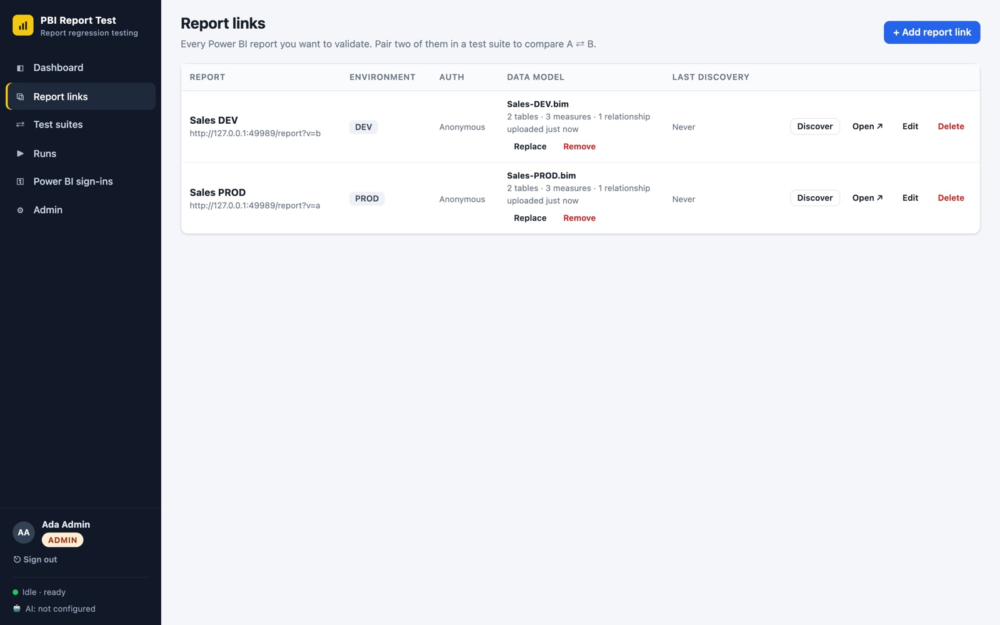
*Figure 24. Report links with an uploaded model file for each report*

Each difference becomes its own check, so you can open it, see the old and new DAX side by side (Figure 25), and **Accept as expected** if it was intended. DAX that was only re-indented or re-spaced is not reported. Security roles are compared only when the account reading the model has administrator rights on it.

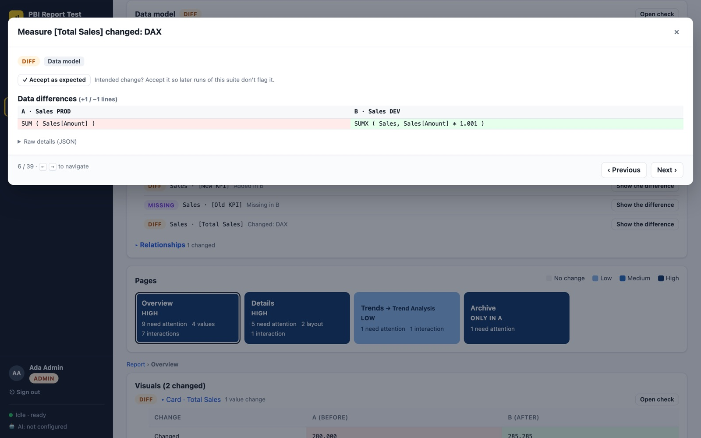
*Figure 25. A changed measure: the DAX in A and in B*

> **Note:** A .pbix file can't be read directly: save it as a template (.pbit) and upload that. Data model checks compare the model's definition, not the data rows in it; the visual and interaction checks cover the numbers.

#### How deep does drilling go, and what does it cost?

In the suite editor (**Scenarios** tab), three limits control drilling:

| Setting | Default | What it does |
|---|---|---|
| **Drill depth (levels)** | 2 | How many levels each drill follows, for example 3 for Year → Quarter → Month → Day. At each level the visual is compared again; if one report's hierarchy ends earlier, that is reported. |
| **Data points drilled per visual** | 1 | Drills on the first data point, or spreads across several (first, middle, last). |
| **Drill-through targets per page** | 3 | How many drill-through target pages are tried per page. |

Each extra level is one more click and comparison per visual, roughly **3 to 10 seconds** on a real report (A and B drill at the same time). As a guide, for a page with 10 drillable visuals:

| Depth × data points | Extra time per page (approx.) |
|---|---|
| 1 × 1 | under a minute |
| 2 × 1 (default) | 1 to 3 minutes |
| 3 × 3 | 5 to 15 minutes |

> **Tip:** Keep the defaults for everyday suites. Raise depth and data points on a separate suite limited to the pages where hierarchies matter (Pages to include), and schedule it overnight.

## 5. Troubleshooting

| What you see | What to do |
|---|---|
| **"PBI Report Test is waking up"** | Normal after a quiet period. Wait up to a minute; the page refreshes by itself. If it takes more than 3 minutes, refresh, then contact your administrator. |
| **"Incorrect email or password"** | Check the email and watch for the Caps Lock warning. Still failing? Ask your administrator to reset your password. |
| **"Too many failed attempts"** | Wait 15 minutes, then try again. |
| **"Your temporary password has expired"** | Ask your administrator for a new temporary password. |
| **"Your session ended"** | You were signed out (inactivity or a password change). Sign in again; you return to the page you were on. |
| **I can't see buttons to add or run things** | You are a viewer. Ask your administrator for the editor role. |
| **A run fails with "Redirected to sign-in"** | The Power BI sign-in expired. An editor signs in or imports it again (4.2), then re-runs. |
| **Many tiny "Diff" results (fractions of a percent)** | Rendering noise. Raise "Max differing pixels" or "layout jitter", or mask the changing area, then re-run. |
| **An intended change is flagged in every run** | Open the check and click **Accept as expected** (editors, see 4.7). |
| **A check is "Accepted" but should not be** | Open it and click **Stop accepting**, or use the suite's Accepted differences tab. |
| **A scheduled run did not happen** | Check the schedule on the suite card (times are India Standard Time). A run more than 24 hours late is skipped rather than run late. |
| **Data model: "not compared" (Skipped)** | The model could not be identified, for example for a publish-to-web link. An editor uploads a .pbit, model.bim or TMDL file on the report link (4.12). |
| **Data model: "Could not read the data model" (Warning)** | The account reading it lacks Build permission on the semantic model, or the sign-in expired. Grant access, sign in again, or upload a model file instead. |
| **Some checks say "Skipped: time budget"** | The run reached its time limit (15 minutes by default) before every interaction was tried; screenshots, layout and data were still checked on every page. Raise the budget, limit the pages, or test more pages at the same time. |
| **Runs got much slower** | Check the suite's drill depth and data points (4.12). Lower them, or limit the pages tested. |
| **Microsoft blocks the sign-in ("You can't get there from here", device not compliant)** | Your organisation only allows sign-ins from managed devices. Use a test account that is allowed to sign in from servers, or ask an administrator to sign in with **npm run login** on a managed computer and **Import** the session. |
| **"… opens on different values: North (A) vs South (B)"** | The two reports open that slicer on different values (a saved default in the report, or a persistent filter). The rest of the page was compared on A's values. If the default in B is wrong, fix it in the report; if it is intended, **Accept as expected**. |
| **Numbers differ only by rounding** | Set a numeric tolerance on the suite, for example 0.001. |
| **A "last refreshed" date always differs** | Add an ignore text pattern such as `Last refreshed: .*`. |
| **The AI tab says AI is not configured** | Ask your administrator to enable AI analysis. |
| **A report can't be opened at all** | Use **Discover** on the report link to see the exact error: wrong address, missing permission, or sign-in needed. |

For anything else, contact your administrator: **Shashank Adari** (shashank.adari@cliffitsolutions.com).

## 6. Glossary

| Term | Meaning |
|---|---|
| **A ⇄ B** | A comparison of a baseline report (A) with a candidate (B). |
| **Accepted** | A difference an editor marked as expected; it no longer counts as a problem. |
| **Audit log** | The record of sign-ins and changes, visible to administrators. |
| **Baseline** | The version considered correct, usually PROD. |
| **Candidate** | The version being checked, usually DEV or UAT. |
| **Cross-filter** | Clicking a data point in one visual to filter the others on the page. |
| **DAX** | The formula language of Power BI measures and calculated columns. |
| **Data model / semantic model** | The tables, relationships, measures and security roles behind a report. |
| **Drill down / expand** | Moving to a lower level of a hierarchy (for example Year → Month) in a visual. The drill depth sets how many levels are tested. |
| **Drill-through** | Right-clicking a data point to open a detail page filtered to it. |
| **Masking** | Painting over an area in both screenshots so it is not compared. |
| **Noise** | Harmless differences such as anti-aliasing or a refresh timestamp. |
| **Schedule** | A cron expression on a suite that starts it automatically, for example 0 6 * * 1-5 for weekdays at 06:00 India time. |
| **Pixel diff** | The share of pixels that differ between two screenshots. |
| **Publish to web** | A public Power BI link (…/view?r=…) that needs no sign-in. |
| **Temporary password** | A generated password for first sign-in or a reset; works once and expires after 72 hours. |
| **Trends** | Charts of a suite's results over time. |
| **Tolerance** | How much difference is accepted before a check reports Diff. |
